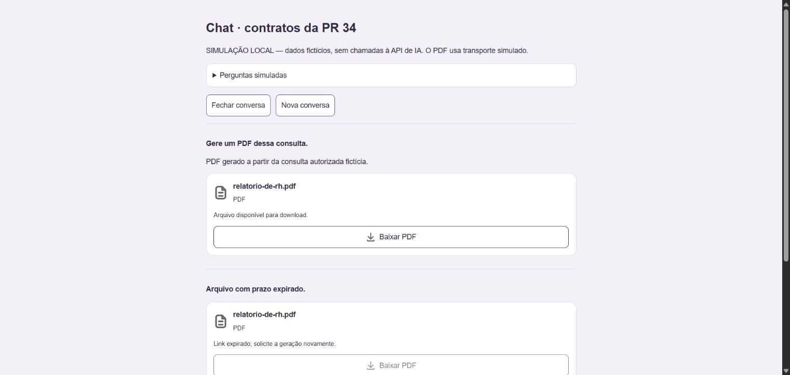
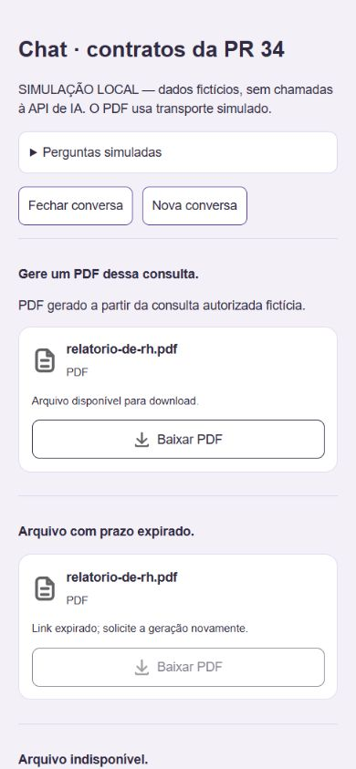

# Homologação web — contratos da API PR 34

Data: 01/11/2026, America/Sao_Paulo. Código baseado na main web `0fbda2d`.
A árvore original de formulários/dashboards com alterações locais foi preservada;
a implementação está em worktree independente. Sem merge ou deploy nesta entrega.

## Referência e versão

A PR [34 da API](https://github.com/Astro-Inter/astro-ai-api/pull/34) estava
incorporada com head `60dfa7cfada3d9f36595fb03eb24fe9b12664ea8`, sem commits posteriores
nessa PR. A main era `a7fbe680520c90355f17f766fb6d21efce4e8f38`.
Foram lidos o schema BlocoArquivo em `app/modules/chat/schemas.py`,
`docs/arquivos-chat.md` e `docs/homologacao-ampliada-pr34.md` nessa revisão.

No início `/version` ainda retornava `3ad06be`; por isso os casos novos começaram
com fixtures. Durante a execução a versão publicada passou a `a7fbe68`, confirmada
novamente antes das leituras reais. O web local foi servido em 127.0.0.1:5175.

## O que já existia e o que mudou

Indicadores v1, matriz v1, contexto v1, tabela v1/v2, ficha e gráficos já eram
compatíveis. Foram preservados parser por bloco, ordem, paginação local, estados
por mensagem e uso de agregados enviados pela API. Nenhum gráfico é calculado
com as linhas da tabela, nem referência de evento gera ação no cliente.

Acrescentado arquivo v1:

- Tipo de domínio e validação isolada de UUID, nome seguro, PDF, tamanho, HTTPS,
  expiração UTC e estado. Tipo inválido não apaga os demais blocos.
- Componente próprio `chatBlockFile`, ícones e CSS do chat existentes.
- Hook `useChatFileDownload` com carregamento, erro, relógio de expiração,
  revalidação em foco/visibilidade e cancelamento na desmontagem.
- Serviço separado do cliente autenticado Astro: só busca por clique, sem
  Authorization/cookies/referrer/cache; limita 2 MB e valida MIME da resposta.
- Download em Blob local, revogado após uso. Sem URL assinada no href do cartão,
  logs, analytics ou persistência. Cartão com data-track-ignore.
- Em falha de download direto, ação explícita para abrir a MESMA URL no navegador,
  noopener/noreferrer, sem renovar nem fabricar outro link. A navegação não depende
  de CORS; erros de armazenamento nessa aba são apresentados pelo próprio navegador.
- Expirado/indisponível não habilita download. Valor tamanho null é omitido.
  Geração sem bloco de arquivo não mostra cartão de sucesso. Prévia somente de
  arquivo usa seu nome, sem URL.

## Testes automatizados

- `npm test`: 577 passaram, zero falhas na suíte completa.
- `node --test tests/chatFiles.test.cjs tests/chatBlocks.test.cjs`: 26 passaram,
  repetidos após os ajustes finais do download e prioridade de estado indisponível.
- `npm run lint`: passou sem avisos.
- `npm run build`: TypeScript e Vite passaram.
- `git diff --check`: passou.

As respostas simuladas usam o schema real. O controlador verdadeiro é exercitado
com POST/histórico simulados: cobertura → matriz → comparação → 100 → 500,
barras globais, linhas com 12 zeros, vazio/sem base, eventos com id/ambiguidade/negação,
PDF/lembrete com mesmo id e prazo, versões desconhecidas, 422/503 e estado isolado.
Paginação não chama rede e não altera agregados. Histórico conserva os blocos.

Download: sem prefetch, sem token/cookies, HTTP 403/500, CORS/rede, MIME incorreto,
tamanho excessivo/vazio, clique duplicado, desmontagem com download pendente,
expiração aberta, ocultação de URL no DOM e erro, abertura explícita da MESMA
capacidade sem rede/API e remoção dessa alternativa ao expirar.

## Interface real com simulação

Página de desenvolvimento `/tools/chat-contracts-preview/index.html`, sem IA ou
operação de negócio. Usa os componentes/hook/serviço reais e transporte fictício
somente para files.example. HTML não é entrada do build de produção.

Verificados pela interface:

- Sete mensagens sucessivas com cobertura, matriz, comparação, listagem 100/500,
  barras e linhas zeradas, sem aviso de blocos descartados.
- Troca para 2/15 da listagem ampliada, primeira listagem mantida em 1/10 e texto
  do gráfico global invariável.
- Vazio com Sem base, eventos com referências 42/43, seleção/ambiguidade/negação.
- Cartão disponível, expirado e indisponível; falha de geração sem cartão;
  falha de download com alerta e desconhecido preservando Antes/Depois.
- Fechar e reabrir histórico remonta os mesmos arquivos; botão válido habilitado.
- Arquivo de cinco segundos passou de habilitado para expirado sem nova consulta.
- Erros 422/503 renderizados explicitamente.
- Layout desktop e emulação web 390×844; largura útil e scrollWidth iguais a
  390 px, sem transbordamento da página. Capturas com dados fictícios abaixo.

O clique de download fictício não mostrou erro no cartão, mas a espera do evento
de download excedeu o prazo da automação. O arquivo salvo pelo navegador NÃO foi
confirmado. A página interna de downloads foi bloqueada pela política do navegador
e não foi acessada por outra via. Serviço, Blob e clique são comprovados em testes
automatizados; o download HTTP real abaixo comprova o conteúdo do armazenamento.

Depois dessas verificações, o controle de navegador foi desativado nas configurações
Work. Não foi possível continuar novas interações visuais; não se afirma ter
verificado visualmente o PDF REAL nem a alternativa de abertura que foi acrescentada
após a constatação de CORS. Essa alternativa tem regressão automatizada.
Não houve teste de app mobile ou aparelho USB; adb não estava disponível no PATH.
O teste mobile desta entrega é somente viewport do web, não aplicativo nativo.

## Interface real contra a API publicada

Antes da interrupção do navegador, conta autorizada com escopo de gestor:

- Cobertura: indicadores, tabela de cinco NRs, barras e contexto.
- Matriz na mesma conversa: indicadores, 100/236 pares, dez páginas e contexto.
- Comparação seguinte: indicadores, tabela, barras e contexto de uma unidade.
- Listagem de 100 seguida do envio de 500 na mesma conversa; resultados finais
  desses dois pedidos não foram lidos antes da interrupção da automação.

Esses números refletem o escopo da conta e não devem ser comparados como se fossem
iguais ao escopo do gestor de workspace dos testes HTTP abaixo.

## Testes reais por HTTP após a interrupção do navegador

Usada outra conta fornecida e autorizada na conversa, com escopo de gestor de
workspace. Login temporário Firebase. Tokens, conteúdo pessoal, identificadores
de seleção e URLs assinadas permaneceram somente em memória; o relatório JSON
versionado contém status, tipos, contagens e resultados booleanos.
Não foram criados eventos/inscrições/evidências. PDF foi explicitamente solicitado.

Resultados em `a7fbe68` (detalhes em [JSON sanitizado](homologacao-pr34-api.json)):

| Caso | Resultado real |
| --- | --- |
| Cobertura | HTTP 200 com somente texto nessa execução; não classificado como entrega analítica aprovada. Não foi substituído por métricas no cliente. A execução visual anterior entregou todos os blocos. |
| Matriz após cobertura | HTTP 200, indicadores + matriz + contexto, 100/272 pares, versão reconhecida e metadados locais. |
| Comparação após matriz | HTTP 200, indicadores + tabela + barras + contexto, três unidades. |
| Lista 100 | HTTP 200, 100/141, solicitada=100, tem_mais=true, limitado=false. |
| Lista 500 na mesma sessão | HTTP 200, 141/141, solicitada=500, tem_mais=false, limitado=false; quinze páginas visuais. |
| Barras com base na listagem | HTTP 200 só texto nessa execução; a agregação real contextual não ficou homologada. A invariância no frontend foi comprovada por simulação. |
| Linhas pessoais | grafico_linhas com 12 pontos, soma zero e todos os valores zero; parser reconheceu. |
| Conflitos vazios | indicadores + contexto, sem tabela/gráfico inventados. |
| Listagem de eventos | Só texto; pedido mais específico informou ausência de eventos. Sem referência disponível para resumo real autorizado; seleção/ambiguidade/negação cobertos por simulação. |
| Validação | mensagem acima do limite do schema recebeu HTTP 422. |
| PDF — primeira tentativa | HTTP 503 com erro explícito, sem bloco arquivo e sem cartão de sucesso. |
| PDF após consulta Meus dados | HTTP 200, texto + arquivo reconhecido, 77.244 bytes, application/pdf, URL e prazo válidos. |
| Download HTTP do PDF | HTTP 200, Content-Type application/pdf, 77.244 bytes, assinatura inicial %PDF-. Nenhum token Astro enviado ao domínio do arquivo. |
| Cadê o PDF? | Mesmo id e URL; formato textual do timestamp variou, mas instante é IGUAL (diferença 0 ms), sem renovação. |
| Histórico PDF | Arquivo presente, mesmo id, mesmo instante de expiração e contrato reconhecido. |

O GET do armazenamento com Origin local não retornou Access-Control-Allow-Origin.
Por isso o cliente mostra erro do download direto se o browser aplicar CORS e
oferece navegação explícita para a mesma capacidade. Homologação visual real desse
caminho ainda depende de reativar o navegador. Nenhuma restrição foi desabilitada.

Histórico analítico: tipos, quantidades recebidas e somas de gráficos dos turnos
aprovados de matriz/comparação/100/500/linhas/conflitos coincidiram com o POST.
Os retornos somente texto de cobertura e barras não constaram como turnos aprovados
nesse recorte. Um turno legado sem bloco e sem snapshot POST correspondente foi
preservado, sem declarar comparação que não podia ser feita.

## Pendências e publicação

1. Revisar/publicar o cliente web compatível e coordenar o mobile, sem merge/deploy
   automático por esta tarefa.
2. Reativar o controle do navegador para testar visualmente a capacidade REAL,
   o salvamento no navegador e a alternativa de abertura após erro de CORS.
3. Homologar resumo com referência de evento legitimamente disponível; não fabricar
   evento para obter resultado. Expiração de cinco horas e falhas do storage têm
   simulação, não espera real de cinco horas nesta execução.
4. Cobertura/barras somente texto e primeira geração 503 ficaram registradas;
   investigar backend se forem indisponibilidade/revisão legítima recorrente,
   sem forçar aprovação ou completar blocos no cliente.
5. Mobile nativo/USB fora do repositório web e sem ferramenta disponível nesta sessão.

Critérios DAD aplicáveis: tipos/estrutura/serviços preservados (M01–M05), estado
local e efeitos com limpeza (M06–M07), chaves/ordem preservadas (M08), botões,
foco/estado/alertas (M11–M12), cancelamento real (E03) e JSX sem HTML externo (E07).
Sem declaração de auditoria WCAG global ou teste com leitor de tela.

