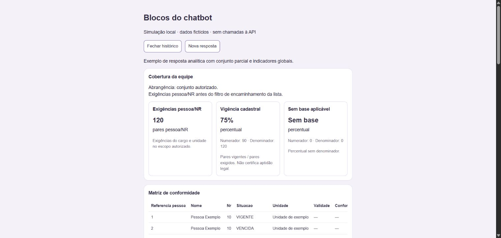
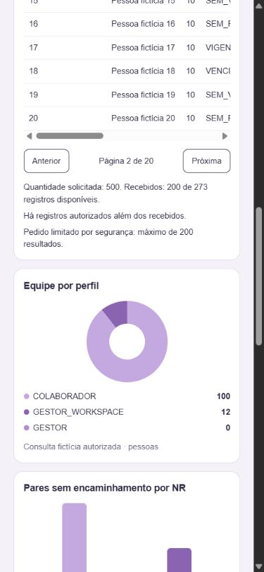

# Homologação do chatbot — PR 70

Validação local em 31/10/2026 (America/Sao_Paulo). A PR 68 estava incorporada;
a PR 70 estava aberta na branch `feat/SCRUM-454-adaptar-fichas-e-fotos-no-chatbot`.
Foi integrada a main web `7af29dc`, preservando a separação parser/hook/componentes,
estilos e acessibilidade. As alterações locais pré-existentes da main em formulários
e dashboards foram preservadas em sua árvore original; trabalho feito em worktree.

## Contrato consultado

A PR [33 da API](https://github.com/Astro-Inter/astro-ai-api/pull/33) estava incorporada
na revisão `f4e91352903d1465e767c384cbb192d3b0335ecf`, sem nova revisão nessa PR.
A main posterior consultada e efetivamente publicada era
`3ad06be7bf696bac04d954439e63fd8be5d66c79`, incluindo `grafico_rosca`.
`GET https://ia.astro-app.solutions/version` confirmou esse commit, `/health`
retornou `ok` e o OpenAPI publicou os quatro discriminadores novos.
Isso substitui a hipótese dos documentos de que a extensão ainda não estava publicada.

Foram lidos os schemas em `app/modules/chat/schemas.py` e os documentos atuais
`contrato-dados-analiticos.md`, `integracao-graficos-chat.md`,
`consultas-gestao-equipe.md` e `homologacao-consultas-gestao.md` da API.

## Já existente e implementado

A main tinha texto, tabelas v1, barras/linhas/setores, galeria legada, avatar seguro,
região de tabela focável, chaves estáveis, cancelamento e isolamento por UID.
A PR 70 já iniciava fichas, células de foto e compatibilidade com POST sem resposta.

Foi mantida essa funcionalidade na arquitetura atual e acrescentado:

- Parser independente por bloco e aviso de tipo/versão inválido, sem JSON bruto.
- Indicadores globais com universo, abrangência, unidade, critério, denominadores
  e percentual nulo como Sem base.
- Matriz longa identificada por referência pessoa/NR, preservando homônimos e
  metadados; sem pivotar ou inferir células ausentes.
- Tabela v2/matriz até 200 linhas, páginas locais de dez, contagens e cortes
  explícitos. Gráficos/indicadores permanecem invariáveis; contratos antigos v1
  continuam com semântica de servidor.
- Rosca própria, zeros preservados, soma zero com estado textual; fontes,
  unidades, legendas acessíveis e tooltips de valores.
- Contexto visível com filtros, período, referência, critérios e avisos.
- Ficha própria com campos opcionais, nome nulo, modalidade, origem nula no legado,
  iniciais/avatar neutro e fallback de foto; conformidade somente quando recebida.
- Prévia compartilhada entre POST e histórico inclusive sem bloco textual.

## Verificação automatizada

- `npm test`: **554 testes passaram**, zero falhas.
- `node --test tests/chatBlocks.test.cjs`: **19 testes passaram**, zero falhas.
- `npm run lint`: passou sem avisos.
- `npm run build`: TypeScript e Vite passaram.
- `git diff --check`: passou.

Os testes usam respostas simuladas e exercitam componentes reais no DOM: 100/200
linhas, navegar até a página 20 sem fetch, mensagens independentes, agregados
invariáveis, cortes por quantidade/tamanho, zero recebido/total positivo,
homônimos, versões/discriminadores, blocos mistos, percentuais sem base e
arredondamento da API, gráficos zerados, fotos ausentes/com erro e legado.
O controlador é exercitado com POST/histórico equivalentes, retomada de sessão
encerrada e troca de UID com resposta pendente abortada, sem vazamento de mensagem.

## Navegador com API real

Login realizado pela interface com a conta autorizada, sem versionar credenciais.
Vite local em `127.0.0.1:5173`; nenhum registro de negócio foi criado.

- “Mostre 100 usuários da minha equipe em uma tabela”: resposta real v2, 100 de
  119 disponíveis. Dez páginas visuais; página 2 funcionou, com aviso de conjunto
  parcial e sem corte de segurança. O conjunto não foi apresentado como completo.
- “Mostre 100 registros da matriz de conformidade da equipe”: duas tentativas
  retornaram erro de conexão na interface. Não houve payload analítico aprovado
  para validar esse cenário real. A causa não foi determinada nesta entrega.
- “Mostre indicadores de cobertura da equipe”: permaneceu em preparação durante
  a observação; a página foi recarregada. Não conta como homologação real aprovada.
- “Meus dados”: ficha própria recebida e exibida; modalidade presente, sem Status
  acrescentado e sem seção de conformidade não solicitada.
- “Qual é meu cargo?”: resposta recebida somente em texto, sem ficha adicional.
- Histórico real: listagem de sessões carregou e incluiu a consulta nova.
  A abertura da sessão não pôde ser confirmada porque a automação perdeu a conexão
  com a aba. Reabertura completa está comprovada pelos testes simulados, não pela
  API real neste registro.

Os demais pedidos analíticos (lacunas por NR, comparação entre unidades, evolução,
resumo de evento, rosca e vencimentos) precisam de homologação real complementar.
Não foram fabricados eventos/participações para obter um resumo autorizado.

## Navegador com fixture

A página `/tools/chat-blocks-preview/index.html` usa componentes reais, dados
fictícios e nenhum endpoint de negócio. A fixture com dez blocos é validada pelo
parser no teste. Desktop e viewport solicitado 390×844 foram inspecionados;
a largura útil observada no mobile era 375 px, igual ao scrollWidth da página.

Cartões empilham, tabelas têm rolagem horizontal interna/foco, paginação avançou
para 2/20, rosca manteve categoria zero, legenda e fonte; barras/linhas e contexto
permaneceram separados. Fechar/reabrir histórico removeu e remontou o mesmo
snapshot na página 1/20. Sem percentuais fabricados ou meses preenchidos.

Evidências contêm somente dados fictícios:

## Publicação e pendências

A API com os novos contratos já estava publicada na verificação. Esta entrega
prepara o web compatível e atualiza a PR 70, sem merge ou deploy. Revisar/publicar
o web e coordenar o suporte mobile; repetir as perguntas de gestão no ambiente
da API, verificando disponibilidade/latência e a recuperação real do histórico.
Os cenários extremos têm evidência simulada; os erros de conexão não foram
reinterpretados como conjunto vazio ou percentual zero.
